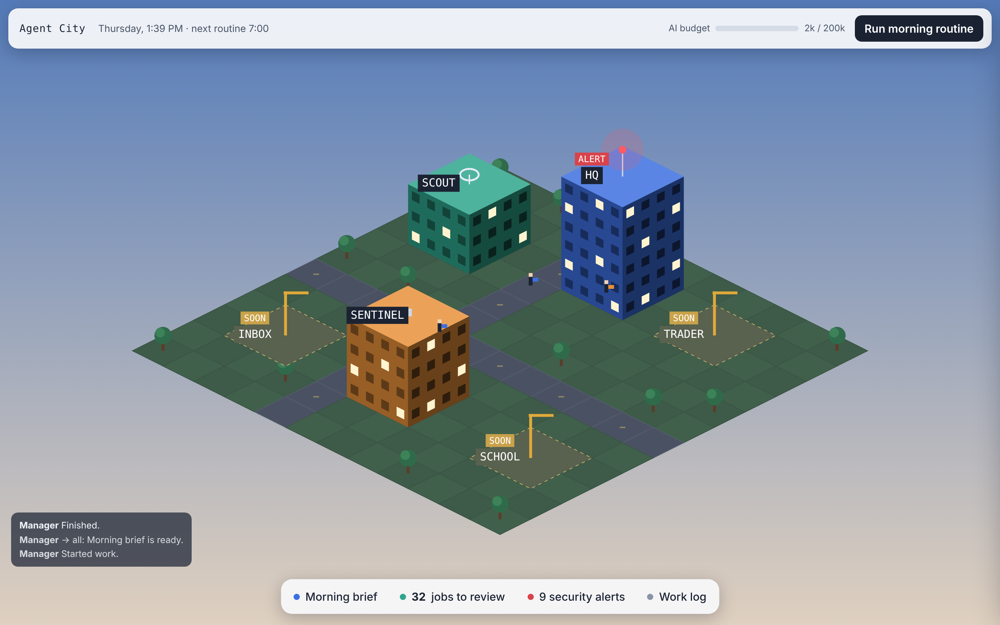
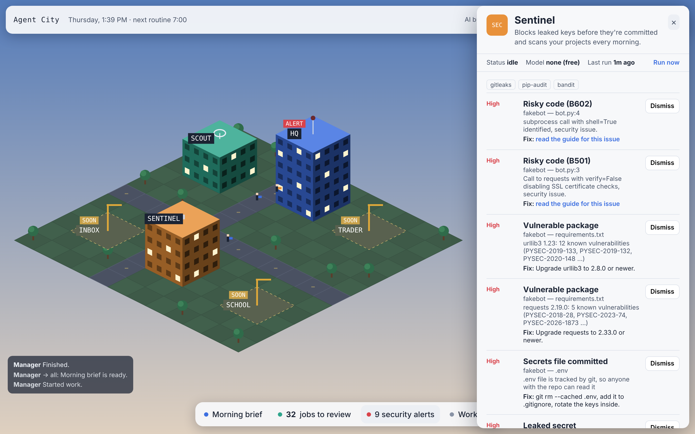

# Agent City

A pixel-art city where each building is an AI agent working for me. Every morning one agent finds jobs that fit me, another checks my code for security problems, and a manager agent reads both reports and writes me a short brief.



Click a building to open that agent:



## Why I built it
I was applying to jobs by hand and wanted a system that does the searching and checking for me while I make the final decisions. I also wanted to see how multi-agent systems work in practice: how agents talk to each other, how to keep their costs down, and how to keep them from doing things they shouldn't.

## The agents
| Building | Agent | What it does | Uses AI? |
|---|---|---|---|
| HQ | **Manager** | Reads the message board and every agent's results, writes the morning brief, answers questions in chat, flags crashed agents | Yes (mid-tier model) |
| Scout | **Job Scout** | Pulls fresh postings from the SimplifyJobs lists plus 27 finance/fintech company boards (Greenhouse), filters and scores them, learns from my approve/skip clicks, and queues the best ones | Rules + one batched AI re-rank per day |
| Sentinel | **Sentinel** | Blocks commits that contain secrets (pre-commit hook), scans files *and git history* with gitleaks, finds vulnerable packages with pip-audit and risky code with Bandit, and reports agents that break their permissions or receive prompt-injection attempts | No (free) |

Agents communicate through a shared **message board**. Everything they do is written to an **activity log**, and the city animates in real time: windows light up while an agent works, messages travel between buildings, and HQ flashes red when Sentinel finds a high-risk issue.

## How it works
```
 run.py morning / 7:00 scheduler / "Run" button
        │
        ▼
 Job Scout ──┐         Sentinel ──┐
  rules →    │  message  gitleaks │
  learning → ├─ board ─► pip-audit├──► Manager ──► Morning brief + chat
  AI re-rank │  (SQLite) patterns │
             ▼                    ▼
        jobs table          findings table
                     │
          FastAPI server ──► pixel city dashboard (canvas, polls every 3s)
```

**Design choices**
- **Cheapest tool first.** Filtering, scoring and security scanning are plain code. AI is only used where judgment helps, and the Scout sends all its top matches in *one* request instead of one per job.
- **Model tiers.** Workers use the cheapest model (or a free local model through Ollama), the manager uses a mid-tier model, and the most expensive model is reserved for rare heavy jobs.
- **No paid API required.** The AI layer runs through the Claude Code CLI on my existing subscription; an API key or no AI at all also work, and every agent has a rule-based fallback.
- **Daily token budget.** When the city hits its budget, agents stop calling the AI until tomorrow.
- **Human in the loop.** The Scout queues jobs; nothing is applied to without my click.
- **Enforced agent permissions.** Agents reach the internet only through `Agent.fetch()` and the AI only through `Agent.think()`; both check `PERMISSIONS` in `config.py`, refuse anything not listed, and log it for Sentinel.
- **Prompt-injection defense.** Job postings are untrusted. Suspicious ones are held back from the AI, the rest are cleaned and fenced in `<untrusted>` tags, and the AI brain runs with no tools at all (`--tools ""`), so even a successful injection can't run commands or read files.
- **Secrets never stored.** Sentinel records *where* a secret is and what kind, never its value.

## Results so far
- First run: the Scout checked **2,245** active postings and queued **37–41** matches after filtering out defense contractors, senior roles, off-topic fields and companies I've already applied to.
- Sentinel, tested on a deliberately broken project, caught an API key that had been committed and then deleted (still in git history), a committed `.env`, 3 outdated packages with 19 known vulnerabilities, `shell=True` and disabled TLS checks. The pre-commit hook blocked a commit containing a GitHub token, with and without gitleaks installed.
- Sentinel also flagged two weak spots in Agent City's own code (a SHA-1 call and unchecked URL schemes), which I fixed.
- A full morning run (all three agents) used about **5,000 tokens**.

## Limitations and next steps
- Approving a job doesn't yet generate the tailored CV and cover letter (next).
- Phone alerts through Telegram.
- Inbox, School and Trading Tower buildings are placeholders.
- Runs on my laptop; a GitHub Actions version would let it run while the laptop is closed.

## Setup
```bash
git clone https://github.com/Waleed-Saffouri/agent-city.git
cd agent-city
python3 -m venv .venv && source .venv/bin/activate
pip install -r requirements.txt
python run.py morning          # run all agents once
python run.py protect ~/code/my-repo   # add the leak-blocking pre-commit hook to any repo
uvicorn server:app             # open http://localhost:8000
```
Optional: install [Claude Code](https://claude.com/claude-code) and log in for the AI layer, [Ollama](https://ollama.com) for free local workers, and `gitleaks` + `pip-audit` for deeper security scans. Run tests with `python -m pytest -q`.

## Tech stack
Python · FastAPI · SQLite · HTML canvas · Claude (via Claude Code CLI or API) · Ollama · gitleaks · pip-audit · pytest
